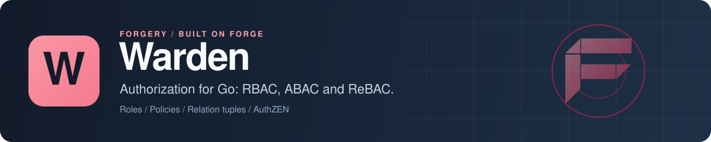

<p align="center">
  
</p>

# Warden: RBAC, ABAC and ReBAC authorization for Go

Warden is an authorization engine for Go. It answers "may this subject do this action on this resource?" by combining role-based access control (RBAC), attribute-based policies (ABAC) and Zanzibar-style relationship-based access control (ReBAC) behind one `Check` call, with every role, policy and relation scoped to a tenant. You can manage permissions in code, through a REST and AuthZEN API, or declare them in `.warden` files that a CLI lints, diffs and applies. It runs inside your process against your own database, and it ships as a [Forge](https://github.com/xraph/forge) extension too.

[](https://go.dev/dl/) [](https://github.com/xraph/warden/actions/workflows/ci.yml) [](https://pkg.go.dev/github.com/xraph/warden) [](https://github.com/xraph/warden/releases) [](https://github.com/xraph/warden/stargazers) [](LICENSE)

[Documentation](https://www.xraph.com/docs/warden) · [Quick start](#quick-start) · [Features](#why-warden) · [Models](#how-a-check-is-decided) · [Declarative config](#declare-permissions-in-warden-files) · [Middleware](#protect-forge-routes) · [Forge](#use-it-with-forge) · [FAQ](#faq)

## Quick start

You need [Go 1.26 or later](https://go.dev/dl/).

```bash
go get github.com/xraph/warden@latest
```

Save this as `main.go`. It creates a role with one permission, gives it to a user, and checks two actions:

```go
package main

import (
	"context"
	"fmt"
	"log"

	"github.com/xraph/warden"
	"github.com/xraph/warden/assignment"
	"github.com/xraph/warden/permission"
	"github.com/xraph/warden/role"
	"github.com/xraph/warden/store/memory"
)

func main() {
	ctx := warden.WithTenant(context.Background(), "docs-app", "acme")
	s := memory.New()

	eng, err := warden.NewEngine(warden.WithStore(s))
	if err != nil {
		log.Fatal(err)
	}

	// An editor role that can read documents. The store assigns the IDs.
	editor := &role.Role{TenantID: "acme", Name: "Editor", Slug: "editor"}
	if err := s.CreateRole(ctx, editor); err != nil {
		log.Fatal(err)
	}
	err = s.CreatePermission(ctx, &permission.Permission{
		TenantID: "acme", Name: "document:read", Resource: "document", Action: "read",
	})
	if err != nil {
		log.Fatal(err)
	}
	if err := s.AttachPermission(ctx, "acme", editor.ID, permission.Ref{Name: "document:read"}); err != nil {
		log.Fatal(err)
	}

	// Give alice the role.
	err = s.CreateAssignment(ctx, &assignment.Assignment{
		TenantID: "acme", RoleID: editor.ID, SubjectKind: "user", SubjectID: "alice",
	})
	if err != nil {
		log.Fatal(err)
	}

	result, err := eng.Check(ctx, &warden.CheckRequest{
		Subject:  warden.Subject{Kind: warden.SubjectUser, ID: "alice"},
		Action:   warden.Action{Name: "read"},
		Resource: warden.Resource{Type: "document", ID: "doc-123"},
	})
	if err != nil {
		log.Fatal(err)
	}
	fmt.Printf("alice read: %v (%s)\n", result.Allowed, result.Decision)

	canDelete, err := eng.CanI(ctx, warden.SubjectUser, "alice", "delete", "document", "doc-123")
	if err != nil {
		log.Fatal(err)
	}
	fmt.Printf("alice delete: %v\n", canDelete)
}
```

Run it:

```bash
go mod tidy
go run .
# alice read: true (allow)
# alice delete: false
```

`Check` gives you the decision with a reason and what matched. If you'd rather have an error on deny, for a code path that should just stop, use `Enforce`, and when all you want is a boolean, `CanI` is the one-line form. You set the tenant with `warden.WithTenant` here. Under Forge you don't have to, because Warden reads it from `forge.Scope` (app ID and org ID). If you check with no tenant at all, you get `ErrTenantRequired` unless you turn `RequireTenant` off.

## Why Warden?

Most apps start with an `isAdmin` column and end up needing roles per organization, a deny rule for one region, and "anyone who can edit the folder can edit the document". Warden gives you all three models over the same data, so you add the next one when you need it without moving to a different system.

| You need | Warden gives you |
| --- | --- |
| Roles and permissions | Roles with inheritance, permissions attached by name, and assignments to users or other subjects, optionally scoped to one resource |
| Rules on attributes | ABAC policies with conditions such as `eq`, `in`, `contains`, `gt`, `ip_in_cidr`, `time_after` and `regex`, explicit deny, and obligations |
| Sharing and hierarchies | Relation tuples (`object#relation@subject`) and a graph walk with depth, fanout and visit budgets |
| Multi-tenant isolation | A tenant in every key, and a wrong-tenant lookup that looks exactly like a missing row |
| Config as code | The `.warden` language, plus a `warden` CLI and a language server for VS Code |
| An API for other services | A REST management API under `/v1`, check endpoints, and the [AuthZEN](https://openid.net/wg/authzen/) evaluation API |
| Answers you can audit | A check log written for every decision (including errors), lifecycle hooks and a structured audit-log plugin |
| Speed | An in-memory LRU check cache with TTL, invalidated by the hooks |
| Your database | PostgreSQL, SQLite and MongoDB through [Grove](https://github.com/xraph/grove), and an in-memory store |

## How a check is decided

Every time you call `Check`, Warden runs the models in this order:

1. RBAC resolves the subject's roles, including inherited ones, and looks for a matching permission.
2. ReBAC walks relation tuples, unless RBAC already allowed the request (set `EvaluateAllModels` to run it anyway).
3. ABAC evaluates active policies. It always runs, because an explicit deny has to be able to override an allow from the other two.

Then the results merge. An explicit deny from a policy wins. Otherwise any allow from any model grants access, and if nothing matches, you get a default deny carrying the most useful reason Warden found, which is what you'll want to log when a user asks why they were refused. Obligations from every matched policy ride along on the result whichever way the decision went.

`Check` fails closed. A store or evaluation error returns no result and the error, and it still writes a check-log entry with decision `error`. If you want to try a request without side effects, pass `warden.WithCallDryRun()`, which skips the cache, the check log and the hooks.

The [decision model docs](https://www.xraph.com/docs/warden/concepts/decision-model) and the [check engine page](https://www.xraph.com/docs/warden/authorization/check-engine) go deeper.

## Declare permissions in .warden files

You don't have to create roles from Go. You can describe a tenant's model in a `.warden` file, keep it in your repository and review it like code:

```text
warden config 1
tenant acme

resource document {
  relation owner:  user
  relation viewer: user

  permission read   = viewer or owner
  permission delete = owner
}

permission "document:read"   (document : read)
permission "document:delete" (document : delete)

role viewer {
  name   = "Viewer"
  grants = ["document:read"]
}

role admin : viewer {
  name   = "Administrator"
  grants += ["document:delete"]
}
```

Install the CLI and check it:

```bash
go install github.com/xraph/warden/cmd/warden@latest
warden lint authz.warden
warden apply -f authz.warden --store memory: --dry-run
```

`warden apply` and `warden diff` take a store DSN (`memory:`, `sqlite:./warden.db` or a `postgres://` URL), or read it from `WARDEN_STORE_DSN` so a password stays out of your shell history. `warden fmt` formats files, `warden export` dumps a tenant's current state back to `.warden` files, and `warden lsp` starts the language server. Apply is idempotent, and `--prune` deletes entries that are not in the files. `${NAME}` placeholders expand from `--var NAME=value` or `WARDEN_VAR_NAME`.

From Go, `dsl.ApplyFS(ctx, eng, fsys, root, dsl.ApplyOptions{TenantID: "acme"})` applies an embedded config tree at boot. The [standalone-embed example](_examples/standalone-embed/) shows it with `//go:embed`. Prebuilt `warden` and `warden-lsp` binaries for Linux, macOS and Windows are on [GitHub Releases](https://github.com/xraph/warden/releases), and the VS Code extension lives in [editor/vscode-warden](editor/vscode-warden/).

## Protect Forge routes

The `middleware` package guards your own Forge routes:

```go
router.GET("/documents/:id", getDocument,
	forge.WithMiddleware(wardenmw.Require(eng, "read", "document")),
)
```

`Require` takes the subject from `forge.UserIDFromContext` and the resource ID from the `:id` path parameter. A caller with no identity gets a 401 (or runs as the fixed subject `anonymous` with `wardenmw.AllowAnonymous()`), a denied check gets a 403, and a store error a 503. `RequireAny` and `RequireAll` take a list of checks, and `WithContext` adds request attributes for your ABAC conditions. Read the [middleware guide](https://www.xraph.com/docs/warden/integration/middleware) for the details.

## Storage backends

Every backend implements `store.Store` with `Migrate`, `Ping` and `Close`, so you can swap one for another without touching your checks.

| Backend | Package | Constructor |
| --- | --- | --- |
| In-memory | `store/memory` | `memory.New()` |
| PostgreSQL | `store/postgres` | `postgres.New(db *grove.DB, opts...)` |
| SQLite | `store/sqlite` | `sqlite.New(db *grove.DB, opts...)` |
| MongoDB | `store/mongo` | `mongo.New(db *grove.DB, opts...)` |

Call `Migrate(ctx)` before first use, or let the Forge extension do it on start. When you migrate yourself, register Grove's migration executor with a blank import of `github.com/xraph/grove/drivers/pgdriver/pgmigrate` or `.../sqlitedriver/sqlitemigrate`.

## Caching and hooks

If you give the engine a cache, repeated checks skip the store:

```go
eng, err := warden.NewEngine(
	warden.WithStore(s),
	warden.WithCache(cache.NewMemory(cache.WithTTL(5*time.Minute), cache.WithMaxSize(10000))),
)
```

With a cache configured, the engine registers a hook that drops affected entries when roles, permissions, assignments, relations or policies change. Those hooks fire from the management API, the dashboard and the DSL applier. If you write to the store directly, as the quick start does, call `eng.InvalidateTenant` or `eng.InvalidateSubject` yourself.

Plugins register with `warden.WithPlugin`. A plugin implements `plugin.Plugin` (just `Name()`) and any of 19 hooks covering checks, roles, permissions, assignments, relations, policies, obligations, audit events and shutdown. Hook errors and panics are logged and counted, and they never block the caller. `plugin/auditlog` writes one structured log line per audit event, and `keysmithbridge` lets [Keysmith](https://github.com/xraph/keysmith) assign Warden roles to API keys without either module importing the other. See the [plugin system docs](https://www.xraph.com/docs/warden/integration/plugin-system).

## Use it with Forge

The `extension` package registers Warden as a [Forge extension](https://github.com/xraph/forge#extensions). It reads `extensions.warden` (or a top-level `warden` key) and validates it, builds a store from the container's `*grove.DB`, provides `*warden.Engine` for injection, mounts the management API under `/warden`, runs migrations on start, and can apply `.warden` files at startup.

```bash
go get github.com/xraph/warden@latest github.com/xraph/grove/extension@latest
```

```go
import (
	grove "github.com/xraph/grove/extension"
	wardenext "github.com/xraph/warden/extension"
	wardenmw "github.com/xraph/warden/middleware"
)

authz := wardenext.New()

app := forge.NewApp(forge.AppConfig{
	Name: "docs-api",
	Extensions: []forge.Extension{
		grove.New(), // extensions.grove: driver and dsn
		authz,       // extensions.warden
	},
})

// The engine exists once the extension has registered, so mount
// guarded routes from a hook that runs before the server listens.
err := forge.OnBeforeRun(app, "document-routes", func(_ context.Context, a forge.App) error {
	return a.Router().GET("/documents/:id", getDocument,
		forge.WithMiddleware(wardenmw.Require(authz.Engine(), "read", "document")),
	)
})
```

List Grove first, because Warden looks up the database during `Register`. If you don't use Grove, pass your store with `wardenext.WithStore(...)`.

The management API requires an authenticated caller on every route by default. Turning that off with `auth.require_identity: false` is refused at startup unless you also pass `wardenext.WithInsecureAllowUnauthenticatedRoutes()`, so nobody switches it off by accident. Being signed in is not enough on its own, either: the API also authorizes each call, and nobody holds the management permissions until something grants them. Call `authz.BootstrapAdmin(ctx, tenantID, subject)` once per tenant, after start, to create a `warden-admin` role and assign it to your first operator. It's safe to call again.

## Configuration

```yaml
extensions:
  warden:
    base_path: /warden
    grove_database: primary          # optional; the default *grove.DB otherwise
    max_graph_depth: 10
    cache_ttl: 5m                    # > 0 builds an in-memory check cache
    evaluate_all_models: false
    check_log_retention: 2160h       # 90 days; negative turns purging off
    maintenance_interval: 1h
    auth:
      require_identity: true
      allow_anonymous_checks: false  # opens only the three /v1/authz check routes
      audit_log: true
    declarative_on_start: true
    declarative_path: ./authz/       # file, directory or glob
    declarative_strict: true         # fail startup on diagnostics
    declarative_prune: false
    dashboard:
      tenant_id: acme                # single-tenant deployments only
```

| Key | What it does | Default |
| --- | --- | --- |
| `disable_routes`, `disable_migrate` | Skip the HTTP API, or migrations on start | `false` |
| `base_path` | Prefix for the management API | `/warden` |
| `max_graph_depth`, `max_graph_visited`, `max_graph_fanout` | ReBAC graph walk budgets | depth `10` |
| `cache_ttl`, `cache_max_size` | Build a memory check cache when the TTL is above zero | no cache |
| `evaluate_all_models` | Run ReBAC even after RBAC allowed | `false` |
| `require_tenant`, `enable_check_log` | Turn off the tenant requirement or the check log | both on |
| `check_log_retention`, `maintenance_interval` | Check-log purge age and how often maintenance runs | 90 days, `1h` |
| `max_batch_checks`, `check_log_queue_size` | Batch and queue bounds | engine defaults |
| `auth.*` | Identity, anonymous checks and the audit-log plugin | identity on, audit log on |
| `declarative_*` | Apply `.warden` files on start, with `declarative_paths`, `declarative_tenant_id`, prune and strict mode | off |
| `dashboard.tenant_id` | Tenant for dashboard requests with no tenant claim | empty |

The options are `WithStore`, `WithConfig`, `WithEngineOptions`, `WithPlugin`, `WithDisableRoutes`, `WithDisableMigrate`, `WithBasePath`, `WithRequireConfig`, `WithGroveDatabase` and `WithInsecureAllowUnauthenticatedRoutes`. The Forge dashboard shows Warden through a React plugin; [MIGRATION.md](MIGRATION.md) maps each old templ page to its new route.

## Documentation

| Topic | Where |
| --- | --- |
| Getting started | [Getting started](https://www.xraph.com/docs/warden/getting-started), [architecture](https://www.xraph.com/docs/warden/architecture), [standalone usage](https://www.xraph.com/docs/warden/guides/standalone-usage), [full example](https://www.xraph.com/docs/warden/guides/full-example) |
| Concepts | [Authorization models](https://www.xraph.com/docs/warden/concepts/authorization-models), [decision model](https://www.xraph.com/docs/warden/concepts/decision-model), [multi-tenancy](https://www.xraph.com/docs/warden/concepts/multi-tenancy), [namespaces](https://www.xraph.com/docs/warden/concepts/namespaces) |
| Authorization | [Roles and permissions](https://www.xraph.com/docs/warden/authorization/roles-permissions), [policies and conditions](https://www.xraph.com/docs/warden/authorization/policies-conditions), [relations and tuples](https://www.xraph.com/docs/warden/authorization/relations-tuples), [resource types](https://www.xraph.com/docs/warden/authorization/resource-types) |
| Declarative config | [DSL reference](https://www.xraph.com/docs/warden/integration/dsl-reference), [DSL tooling](https://www.xraph.com/docs/warden/integration/dsl-tooling) |
| Integration | [Forge extension](https://www.xraph.com/docs/warden/integration/forge-extension), [middleware](https://www.xraph.com/docs/warden/integration/middleware), [plugin system](https://www.xraph.com/docs/warden/integration/plugin-system), [REST API](https://www.xraph.com/docs/warden/api-reference/rest-api) |
| Storage | [PostgreSQL](https://www.xraph.com/docs/warden/stores/postgres), [SQLite](https://www.xraph.com/docs/warden/stores/sqlite), [MongoDB](https://www.xraph.com/docs/warden/stores/mongo), [memory](https://www.xraph.com/docs/warden/stores/memory), [custom store](https://www.xraph.com/docs/warden/guides/custom-store) |

The Go API is on [pkg.go.dev](https://pkg.go.dev/github.com/xraph/warden).

## Examples

| Example | What it shows |
| --- | --- |
| [standalone](_examples/standalone/) | Warden without Forge, as in the quick start |
| [rbac](_examples/rbac/) | Roles with inheritance |
| [rebac](_examples/rebac/) | Zanzibar-style relation tuples |
| [abac](_examples/abac/) | Attribute-based policies |
| [standalone-embed](_examples/standalone-embed/) | Applying an embedded `.warden` config tree at boot |
| [declarative](_examples/declarative/) | A `.warden` file with a policy and an obligation |
| [forge](_examples/forge/) | Warden as a Forge extension |

Run one from the repository root, for example `GOWORK=off go run ./_examples/rbac`.

## FAQ

### How do I add role-based access control to a Go API?

Create roles and permissions, assign roles to users, and call `eng.Check` or `eng.Enforce` before the protected action. On Forge routes, `middleware.Require(eng, "read", "document")` does it for you.

### Can I use RBAC and ReBAC together in Go?

Yes. Warden evaluates both on every check (ReBAC only when RBAC has not already allowed), and ABAC policies on top. Any allow grants access unless a policy explicitly denies.

### Is Warden a Zanzibar implementation?

Its ReBAC model uses Zanzibar-style relation tuples and a graph walk, inside your own process and database. There is no separate authorization service to run.

### Does Warden support AuthZEN?

Yes. The management API serves the AuthZEN evaluation endpoints at `/access/v1/evaluation` and `/access/v1/evaluations`, next to Warden's own `/v1/authz/check`, `/enforce` and `/batch-check`.

### Can I use Warden without Forge?

Yes. The engine, stores, DSL and CLI are plain Go. Only the `extension` and `middleware` packages expect a Forge app.

## Contributing

Bug reports and focused pull requests are welcome. `main` is protected, so every change lands through a pull request with passing checks. [CONTRIBUTING.md](CONTRIBUTING.md) has the guidelines.

```bash
git clone https://github.com/xraph/warden.git
cd warden
make check              # fmt, vet and lint
make test               # memory and SQLite
make test-integration   # PostgreSQL and MongoDB, through Docker or WARDEN_TEST_DSN and WARDEN_TEST_MONGO_URI
```

Without Docker or those variables, the integration tests skip and the run still passes, so read the output for skips. [AGENTS.md](AGENTS.md) has the coverage gate, the lint rules that bite and the release steps. Commits follow [Conventional Commits](https://www.conventionalcommits.org/).

## License

Warden is available under the [Apache License 2.0](LICENSE).

Warden is part of the [Forge](https://github.com/xraph/forge) forgery stack, built by [Rex Raphael](https://github.com/juicycleff) and [contributors](https://github.com/xraph/warden/graphs/contributors).
